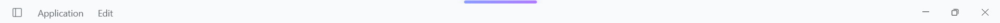
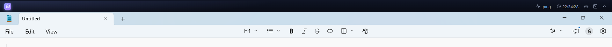

# topbar_deepseek

[](https://github.com/tehnplk/topbar_deepseek/actions/workflows/ci.yml)

แถบ **Top Sticky Bar** ความสูง **30 DIP** ที่จองพื้นที่ด้านบนสุดของหน้าจอ แล้วดันหน้าต่างแอปอื่น
(รวมถึงหน้าต่างที่ maximize) ลงมา — สร้างด้วย **Electron + React + TypeScript + Vite**
พร้อมไอคอนจาก **lucide-react**


กดคลิกขวาที่แถบ → "ย่อแถบ" แล้วแถบจะหดเหลือเส้นบาง ๆ ตรงกลางจอ และคืนพื้นที่ให้เดสก์ท็อป —
คลิกที่เส้นเพื่อขยายกลับ



แอปอื่นถูกดันลงมา: หน้าต่าง Notepad ที่ maximize จะเริ่มใต้แถบพอดี



## แสดง HN จาก HOSxP

ถ้าเปิด HOSxP ไว้ที่หน้าจอไหนก็ตาม แถบจะแสดง **HN ของผู้ป่วยที่เปิดอยู่ในหน้าจอนั้น**
ต่อจากไอคอนแอป เช่น `HN : 000000000` (ถ้าไม่พบ HN จะซ่อนส่วนนี้ไว้)

HOSxP เป็นแอป Delphi/DevExpress ที่วาดข้อความเอง ทำให้ `WM_GETTEXT` / `GetWindowText`
อ่านค่าไม่ได้ — ตัวอ่านจะไล่ดู **หน้าต่าง HOSxP ที่มองเห็นทั้งหมด** (ฟอร์มหลักและ dialog
เช่น `TPatientVisitEntryForm`) โดยเริ่มจากหน้าต่างที่กำลัง active แล้วเลือก 2 ทาง:
1. อ่าน HN จาก **caption ของหน้าต่าง** ถ้ามีรูปแบบ `TPatientOPDCardForm:000000000`
2. ถ้า caption ไม่มี ให้หา edit ที่อยู่ทางขวาของ label "HN" ในหน้าต่างนั้น แล้วอ่านค่าผ่าน **MSAA**

ตัวอ่านอยู่ใน `resources/hosxp-hn.ps1` (PowerShell + C# interop) และส่งค่าให้ main process
เป็น JSON ทุกครั้งที่ค่าเปลี่ยน

## ข้อมูลผู้ป่วย (PtInfo)

เมื่อได้ HN มาแล้ว แถบจะดึงชื่อ–เพศ–อายุจากฐานข้อมูล HOSxP มาแสดงต่อท้าย เช่น
`นายทดสอบ ระบบ · ชาย · 40-0-0` (อายุอยู่ในรูป ปี-เดือน-วัน)

ตั้งค่าการเชื่อมต่อใน `.env` (คัดลอกจาก `.env.example`):

| ตัวแปร | ตัวอย่าง | ความหมาย |
| --- | --- | --- |
| `DB_HOST` | `127.0.0.1` | โฮสต์ MySQL/MariaDB |
| `DB_PORT` | `3306` | พอร์ต |
| `DB_USER` | `root` | ผู้ใช้ที่อ่านตาราง `patient` ได้ |
| `DB_PASSWORD` | — | รหัสผ่าน |
| `DB_NAME` | `your_hosxp_db` | ชื่อฐานข้อมูล HOSxP |

`getPtInfo(hn)` ใน `src/main/db.ts` คืนค่า
`{ hn, fullname, sex, age: { y, m, d }, ageYmd }` หรือ `null` เมื่อไม่พบ HN / ต่อฐานข้อมูลไม่ได้
และอ่านผ่าน IPC `window.api.ptInfo(hn)` ได้จาก renderer

## หลักการทำงาน

1. สร้าง `BrowserWindow` แบบ frameless, always-on-top, ไม่โชว์ใน taskbar สูง 30 DIP เต็มความกว้างจอหลัก
2. เรียก Win32 **AppBar** ผ่าน FFI ([koffi](https://koffi.dev)) — `SHAppBarMessage(ABM_NEW → ABM_QUERYPOS → ABM_SETPOS)`
   ทำให้ Windows ลด **work area** ลง 30 DIP ด้านบน
3. Windows บังคับความสูงขั้นต่ำของหน้าต่าง (ประมาณ 38 DIP จาก minimum frame height) โค้ดจึง
   **เลื่อนหน้าต่างขึ้นเหนือขอบจอ** และยึดเนื้อหาแถบไว้ด้านล่างของหน้าต่าง → ผู้ใช้เห็นแถบสูง 30 DIP
   เต็มพื้นที่ที่จองไว้ และไม่มีช่องว่างหรือแถบทับแอป
4. รับข้อความ `ABN_POSCHANGED` ผ่าน `hookWindowMessage` เพื่อจัดตำแหน่ง/จองพื้นที่ใหม่เมื่อ
   taskbar ย้าย รีโซลูชันหรือ DPI เปลี่ยน
5. **ย่อ:** เรียก `ABM_REMOVE` คืนพื้นที่ แล้วหดหน้าต่างเหลือ 132 DIP ตรงกลางจอและเลื่อนขึ้นเหนือขอบ
   จอให้เหลือเส้นบาง ๆ 6 DIP — **ขยาย:** จองพื้นที่ (AppBar) กลับและคืนขนาดเต็ม
6. ปิดแอป (คลิกขวาบนแถบ → "ปิด topbar_deepseek" หรือ Alt+F4) → `ABM_REMOVE` คืนพื้นที่ให้เดสก์ท็อปทันที

## โครงสร้างโปรเจกต์

```
src/
├── main/
│   ├── index.ts     # app lifecycle, display listeners
│   ├── bar.ts       # สร้างหน้าต่างแถบ, จัดตำแหน่ง, สถานะย่อ/ขยาย, เมนูคลิกขวา
│   ├── appbar.ts    # Windows AppBar ผ่าน koffi (จอง/คืนพื้นที่ + จัดตำแหน่ง)
│   ├── hosxp.ts     # spawn ตัวอ่าน HN ของ HOSxP + ส่งสถานะเข้า renderer
│   ├── db.ts        # connection pool + getPtInfo(hn) จากฐานข้อมูล HOSxP
│   └── ipc.ts       # IPC handler ทั้งหมด (ping, status, collapse, hosxp, devtools, quit)
├── preload/
│   ├── index.ts     # contextBridge → window.api
│   └── index.d.ts
├── renderer/        # UI แถบ 30 DIP (React + Vite + lucide-react)
│   └── src/
│       ├── App.tsx
│       ├── types.ts
│       └── assets/
├── shared/ipc.ts    # type + ชื่อ channel ที่ใช้ร่วมกันทุก process
resources/
└── hosxp-hn.ps1     # ตัวอ่าน HN ผ่าน MSAA (bundled ไปกับแอป)
```

## คำสั่งที่ใช้บ่อย

| คำสั่ง           | คำอธิบาย                                            |
| ---------------- | --------------------------------------------------- |
| `pnpm dev`       | เปิดแถบโหมดพัฒนา พร้อม HMR (แก้ UI แล้วเห็นผลทันที) |
| `pnpm start`     | รันจากไฟล์ที่ build แล้ว                            |
| `pnpm build`     | typecheck แล้ว build ลง `out/`                      |
| `pnpm typecheck` | ตรวจ type ทั้งฝั่ง Node และฝั่งเว็บ                 |
| `pnpm lint`      | ตรวจโค้ดด้วย ESLint                                 |
| `pnpm build:win` | แพ็กเป็นตัวติดตั้ง Windows (.exe)                   |

## IPC ที่มีให้แล้ว

- `window.api.ping()` — วัด round-trip ไป main process (แสดงเป็น ms บนแถบ)
- `window.api.appBarStatus()` / `onAppBarStatus(cb)` — สถานะการจองพื้นที่, สถานะย่อ, work area ปัจจุบัน
- `window.api.setCollapsed(true | false)` — ย่อ/ขยายแถบ (คืน/จองพื้นที่ตามสถานะ)
- `window.api.hosxpState()` / `onHosxpState(cb)` — สถานะ HOSxP + HN ของผู้ป่วยที่เปิดอยู่
- `window.api.toggleDevTools()` — เปิด/ปิด DevTools
- `window.api.quit()` — ปิดแอปและคืนพื้นที่

## ข้อจำกัดที่ควรรู้

- การจองพื้นที่ทำงานเฉพาะ **Windows** (ใช้ `SHAppBarMessage`) — บน macOS/Linux จะได้แถบ
  always-on-top ธรรมดาโดยไม่จองพื้นที่
- รองรับ**จอหลัก** (primary display) เท่านั้น
- ออกแบบสำหรับ taskbar ด้านล่าง (ค่าเริ่มต้นของ Windows 11)
- แอปแบบ fullscreen (เกม/วิดีโอ) อาจถูกแถบทับ เนื่องจากหน้าต่างเป็น always-on-top
- ไม่มีปุ่มปิดบนแถบแล้ว: ใช้คลิกขวาที่แถบ → "ปิด topbar_deepseek", กด Alt+F4 หรือปิดจาก Task Manager
- การอ่าน HN ต้องรัน HOSxP บนเครื่องเดียวกันและหน้าจอ HOSxP ต้องไม่ถูกย่อ/ซ่อนอยู่ (อ่านจากฟอร์มที่แสดงอยู่)
  และต้องอนุญาตให้รัน PowerShell ได้
- .env ไม่ถูกบรรจุในตัวติดตั้ง — ถ้าแพ็กเป็น .exe ต้องวาง .env ไว้ในโฟลเดอร์ `resources` ของแอป
  หรือกำหนดผ่าน environment variable แทน

## หมายเหตุ

- โปรเจกต์นี้เป็นเครื่องมือส่วนตัว ไม่ได้มีความเกี่ยวข้องหรือได้รับการรับรองจากบริษัทผู้พัฒนา
  HOSxP (BMS) — "HOSxP" เป็นเครื่องหมายการค้าของเจ้าของ
- การอ่านข้อมูลจากหน้าจอ/ฐานข้อมูลของหน่วยงาน ต้องได้รับอนุญาตจากเจ้าของระบบ
  และต้องปฏิบัติตาม PDPA
- ภาพและข้อมูลตัวอย่างใน `docs/` เป็นข้อมูลสมมติ (mock) ไม่ใช่ข้อมูลผู้ป่วยจริง

## License

MIT — ดูรายละเอียดใน [LICENSE](LICENSE)

